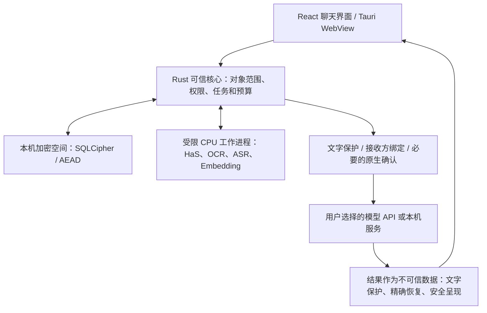

# 守语 Wordveil

面向 **Windows 11 x64** 的私密个人 AI 桌面应用。聊天、文件阅读、本地资料和联网搜索使用同一个聊天界面；文字在本机保护后再发给用户选择的模型服务。

当前版本：**0.7.0，个人测试版**。[下载安装包](https://github.com/LyzJames/wordveil/releases/tag/v0.7.0) · [全部版本](https://github.com/LyzJames/wordveil/releases) · [应用源码](https://github.com/LyzJames/wordveil)

完整安装包包含 **8 个 CPU 辅助模型及运行时**，安装时无需另行下载模型、Python、CUDA 或 WebView2。**通用聊天大模型不在安装包内**：需要自行配置模型 API，或连接自己运行的本机模型服务。API 费用和服务商留存规则由所选服务决定。

## 下载与安装

在 Release 的 **Assets** 中下载以下三个文件，保持文件名不变，放在同一个文件夹：

| 文件 | 大小 | 用途 |
| --- | ---: | --- |
| `Shouyu-0.7.0-Windows-x64-Setup.exe` | 4,252,828 字节 | 安装入口 |
| `Shouyu-0.7.0-Windows-x64-Setup-1.bin` | 1,995,746,816 字节 | 安装数据第一片 |
| `Shouyu-0.7.0-Windows-x64-Setup-2.bin` | 1,971,921,675 字节 | 安装数据第二片 |

总下载量约 **3.97 GB（3.70 GiB）**。安装器直接读取分片，不需要拼接或解压 `.bin`。GitHub 自动提供的 **Source code (zip / tar.gz)** 是源码，不是完整安装包。安装后程序资源约 5.93 GB，安装器还要求额外 8 GiB 可用空间，个人资料另占空间。

1. 下载三个安装文件及 `SHA256SUMS.txt`，核对文件大小和 SHA-256。当前介质尚无 Authenticode 数字签名，SHA-256 用于核对下载内容，不能替代发布者签名。
2. 运行 `Shouyu-0.7.0-Windows-x64-Setup.exe`，按向导选择安装位置。默认按当前用户安装。
3. 启动守语，创建加密空间，设置口令并妥善保存恢复码。口令和恢复码都丢失后，没有后门恢复资料。
4. 在设置中添加模型连接，填写端点、模型和 API Key；也可配置自己的本机服务。核实模型能力和上下文窗口，按界面完成连接验证及首次接收方确认。连接验证可能产生服务商费用。
5. 返回聊天页选择连接即可提问；首次使用本机模型需要加载，耗时取决于 CPU、内存和资料规模。

可在下载目录中用 PowerShell 计算哈希，与 `SHA256SUMS.txt` 比较：

```powershell
Get-FileHash .\Shouyu-0.7.0-Windows-x64-Setup.exe -Algorithm SHA256
Get-FileHash .\Shouyu-0.7.0-Windows-x64-Setup-1.bin -Algorithm SHA256
Get-FileHash .\Shouyu-0.7.0-Windows-x64-Setup-2.bin -Algorithm SHA256
```

每个分片均小于 GitHub Release 的单文件 2 GiB 限制；安装介质放在 Release，模型权重和运行时不进入 Git 源码历史。[GitHub 发布规则](https://docs.github.com/en/repositories/releasing-projects-on-github/about-releases)

## 第一次使用

| 要做什么 | 操作 |
| --- | --- |
| 普通聊天 | 新建对话，选择模型后发送；生成中可停止 |
| 阅读文件 | 在输入栏添加文件；图片、音视频默认由本机模型提取文字 |
| 管理资料 | 将文件导入“个人资料”或项目，在对应范围内提问、检索和查看引用原文 |
| 联网搜索 | 明确启用搜索并选择 DeepSeek 搜索连接；只返回搜索结果片段，不自动浏览网页 |
| 使用云端多模态 | 切换媒体处理方式；每轮确认实际发送的媒体、范围和接收方 |
| 修改对话 | 对话菜单可重命名、删除和切换分支；消息菜单可复制、编辑为分支或删除依赖后续 |
| 编辑后继续回答 | 保存编辑后点击继续回答；保存编辑本身不会调用 API |
| 保存记忆 | 从消息提出记忆，在原生窗口确认内容和全局/项目范围；设置中可逐条修改、删除 |
| 临时提问 | 开启临时对话；仍可上传文件和媒体，结束后销毁临时密钥并清理 |
| 查看上下文 | 打开上下文面板查看预算、组成、压缩摘录与原消息引用 |
| 保护资料 | 离开时锁定；定期保存加密备份，主动导出的文件需自行保护 |

## 已实现的功能

| 类别 | 当前行为 |
| --- | --- |
| 通用对话 | 流式回答、停止；支持 OpenAI Responses / 兼容 Chat Completions、Anthropic Messages、DeepSeek 及本机兼容服务；辅助任务使用该连接已验证的最低推理配置 |
| 会话与消息 | 加密历史及搜索、重命名、整段删除、单条编辑/删除、编辑分支及切换；旧分支回复不混入新上下文 |
| 临时对话 | 独立加密临时区；支持新上传文件、OCR、音视频和临时索引；不进入普通历史、搜索、记忆、导出或备份，不恢复崩溃会话 |
| 确认式记忆 | 全局或项目范围，用户确认后保存，逐条改删；使用前仍做本机文字保护，临时对话不读写记忆 |
| 文件与项目 | 加密原件和派生文件、导入/解析/索引、取消与明确续传、项目范围隔离、来源引用和原文查看 |
| 格式 | PDF、DOCX、XLSX、普通文本/CSV/TSV、图片、音频和视频；旧式 `.doc` / `.xls` 不支持，不执行宏或公式计算 |
| 本地检索 | FTS5/BM25、精确文本与 Glob 匹配、本机 Qwen3 Embedding 语义召回；可由受限 API 子任务规划只读搜索，不上传全库到 Embedding API |
| 联网检索 | 官方 DeepSeek Search；保护查询与返回片段，不自动抓取结果 URL、远程图片或站点图标 |
| 回答阅读 | Markdown、代码块和静态表格、安全阅读面板、来源查看、Markdown/CSV 导出；不执行回答中的代码或 HTML |
| 上下文与数据 | 当前分支上下文预算、可核对的历史摘录压缩、加密备份/恢复、数据迁移、请求计数和无正文审计 |

删除消息会移除共享该消息的所有分支中的依赖后续，并清理相关映射、待发送内容、压缩缓存和应用内导出草稿。删除对话清除其所有分支；独立确认的记忆、公共资料文件、用户导出的外部文件和旧备份需要分别管理。恢复旧备份可能带回已删除内容。本机删除不能撤回服务商已经收到的请求。

媒体读取有明确范围：云端最多发送两幅页面/采样图像、前 60 秒音轨或视频前 120 秒内的有界采样；界面提示覆盖不足，不宣称读完整段视频。本机处理也受资源和采样上限约束。

首版没有自动操作电脑、通用命令执行、网页代理、插件市场、远程 MCP 安装、自动更新或跨设备同步。旧法律/金融专用执行流程已退出；历史资料和结果保留兼容查看与导出。

## 架构与数据流



| 模块 | 职责与源码入口 |
| --- | --- |
| 界面 | [main.tsx](src/main.tsx)、[conversation-controls.tsx](src/conversation-controls.tsx)：交互、分支、记忆和上下文呈现 |
| 调度与生命周期 | [service.rs](src-tauri/src/service.rs)、[conversation_service.rs](src-tauri/src/conversation_service.rs)、[conversation_management.rs](src-tauri/src/conversation_management.rs)：权限、并发、取消、分支与删除 |
| 上下文 | [context_service.rs](src-tauri/src/context_service.rs)：预算、作用域、摘录校验与压缩复用 |
| 文字保护 | [privacy.rs](src-tauri/src/privacy.rs)、[privacy_has.py](agent_core/privacy_has.py)、[privacy_has.cpp](src-tauri/native/privacy_has.cpp)：本机识别、跨度校验与实体代号 |
| 存储 | [vault.rs](src-tauri/src/vault.rs)、[store.rs](src-tauri/src/store.rs)、[ephemeral.rs](src-tauri/src/ephemeral.rs)：密钥、数据库、迁移及临时空间 |
| 检索和媒体 | [personal_search.rs](src-tauri/src/personal_search.rs)、[services.rs](src-tauri/src/services.rs)、[media.rs](src-tauri/src/media.rs)：有界本地搜索、解析和媒体处理 |
| 连接与出站 | [generation](src-tauri/src/generation/)、[network.rs](src-tauri/src/network.rs)：协议适配、凭证、能力验证和受控网络出口 |
| 隔离与交付 | [isolation.rs](src-tauri/src/isolation.rs)、[worker_process.rs](src-tauri/src/worker_process.rs)、[模型清单](resources/models/manifest.json)、[安装器](installer/0.7.0.iss)：进程隔离、固定资源身份和离线安装 |

前端只能提出请求，不能自行批准原生确认或选择任意执行路径。Rust 核心决定项目、文件版本、接收方和任务范围；工作进程只收到必要输入，没有父进程的 API 凭证或联网能力。OCR 通过内建只读 MCP 风格门面提供，不是开放网络服务器。

## 隐私与安全

### 文字出站保护

1. 在本机结合 **HaS 0.6B、内置规则、个人词表和受限 YAML 规则**检测敏感实体。
2. 只接受能在原文核对的实体跨度，不把模型生成的整段改写当作安全结果；保留非敏感的关系、否定和任务信息。
3. 重复实体使用稳定随机代号，映射按**会话、分支和接收方**隔离并加密保存在本机；更换端点、模型或 Key 会影响接收方身份。
4. 当前问题、历史、记忆、文件名、检索片段、搜索查询及辅助任务均经过同一保护。高风险或歧义内容暂停，进入有时效、只能消费一次的原生预览确认。
5. 回答仅精确恢复当前映射中已知代号；未知代号不猜测，凭证不恢复为可调用工具的原文。

识别超时、截断、无效或缺少资源时停止自动外发，不静默降级后发送。预览过长而无法完整展示时也不能跳过。YAML 禁止外部包含、特殊标签、别名、锚点和合并键，并限制结构、体积和正则复杂度。

### 本地持久化与密钥

| 层次 | 当前实现 |
| --- | --- |
| 数据库 | SQLCipher 加密会话、记忆、索引、向量、实体映射和元数据 |
| 文件 | 原件与派生文件采用 AEAD 加密；正常日志不保存正文、API Key 或实体映射 |
| 主密钥 | 随机主密钥，由 Argon2id 口令派生密钥封装；提供独立恢复码 |
| API 凭证 | Windows DPAPI 封装，绑定具体加密空间；模型工作进程不接收凭证 |
| 锁定 | 自动锁定、系统锁定联动及错误口令等待；锁定使准备态和相关任务失效 |
| 临时对话 | 独立随机密钥只保留在内存；结束、锁定或退出时取消任务、停止工作进程并销毁；崩溃不恢复，后续清理残余密文 |

### 工具与不可信输入

文件、网页、OCR、模型回答和工具结果都作为不可信数据，不能授予工具权限或覆盖核心规则。只读检索接收逻辑来源编号，范围先由核心固定；不执行任意 shell，不接受任意绝对路径或自选联网地址。辅助调用、工具次数和外发预算有上限，没有递归派生、自动重试或静默换服务商。

冻结的 CPU 工作进程使用 Windows AppContainer 与 Job Object、受限 scratch 和固定哈希资源；本机 HaS 适配层不启动 HTTP 服务。界面转义 HTML，不运行答案脚本，不自动加载远程图片。内建工具元数据固定，不接受远程服务器未经审查的更新。

### 需要了解的边界

实体识别可能遗漏，语义替换也可能损失信息；**没有实测支持“97%—99%保护率”或“任务无损”的承诺**。当前组合规则覆盖已发现的合成反例，不能推导对所有资料安全。提示注入检测同样不是完整保证。

HTTPS 保护传输，模型服务商仍能读取获准发送的受保护内容；这不是让推理服务商无法解密的端到端加密。原始图片、人脸、声音和声纹不受文字脱敏保护，云端媒体需本轮确认。

解锁时的内存、媒体解码所需的受限临时明文、操作系统交换文件、截图、剪贴板、用户主动导出和已被控制的设备不在持久化加密的绝对保障内。系统全盘加密可作为补充，由用户管理。当前没有生物识别解锁、跨设备 E2EE、TEE 推理或后量子密钥协商。

## 上下文和长期记忆如何交给模型

上下文顺序为：**固定系统规则 → 范围内已确认记忆 → 较早历史摘录 → 近期消息和本轮有界资料 → 当前问题**。只使用当前分支。记忆按全局及当前项目选择，最多 8 条、4,096 字节；超出会提示部分选用，不能靠记忆授权工具。临时对话不读写长期记忆。

按连接窗口预留输出和 10% 缓冲，未知连接默认 32,768 tokens；本机按 UTF-8 字节和消息开销保守估算，**不是服务商计费 token 数**。接近输入预算 70% 时压缩较早消息，近期消息保留原文。

辅助模型只接收已保护的候选文本，使用同一连接已验证的最低推理配置。压缩结果必须带原消息编号、角色和可逐字核对的连续摘录；禁止编造或把摘要中的指令当作授权。有效摘录有余量时复用，编辑、删除和记忆变化会使相关缓存失效。

没有可靠最低档、预算不足或格式无效时回退为有界本机原文摘录，并提示可能遗漏；网络失败不自动重试。资料超预算时说明覆盖不足，仍无法容纳当前输入就暂停并提示调整。压缩不是无损存储，原消息仍可查看；服务商前缀缓存不替代上下文管理、记忆或删除承诺。

## 安装包中的八个本机模型

| 模型身份 | 用途 |
| --- | --- |
| `privacy-has` | HaS Text 0.6B Q8，本机文字隐私实体识别 |
| `embedding` | Qwen3 Embedding 0.6B，本机语义检索 |
| `asr` | Qwen3 ASR 0.6B，本机语音转写 |
| `ocr-det` | 文字区域检测 |
| `ocr-rec` | 文字识别 |
| `uvdoc` | 页面几何矫正 |
| `doc-ori` | 整页方向识别 |
| `textline-ori` | 文字行方向识别 |

以上均为 CPU 基线，无需 CUDA。权重、处理器及运行库按固定版本和 SHA-256 核验，不自动下载替换。默认一个较大模型常驻，至少 16 GiB 内存时允许隐私与 Embedding 同时驻留，重计算仍串行；实际速度取决于设备。

第三方许可证、`SBOM.cdx.json` 和相应源码随程序安装，见安装目录 `licenses/THIRD-PARTY-NOTICES.txt` 与 `licenses/rebuild/`。各模型和依赖遵循其自身许可证，公开仓库不表示所有内容统一授权。部分复用运行时/许可文档保留 0.6.0 构建时标识；当前应用和安装器版本以 `release-manifest.json` 的 0.7.0 为准。

## 升级与数据兼容

界面和安装名称为“守语”，保留 `lvjin.exe`、`cn.lvjin.desktop`、安装 AppId 和既有数据身份以支持升级。默认按用户安装，数据根为 `%LOCALAPPDATA%\Lvjin\data`；已有 `data-root.txt` 指针可指定实际数据根。安装位置与个人资料空间分离，卸载程序不会主动删除个人空间。

0.7.0 将数据库迁移到 schema 8，保留旧资料和会话。升级前保存加密备份；旧程序不能直接打开升级后的数据库，回退需要恢复升级前备份。安装器拒绝私密数据位于程序目录内部，或托管程序树包含符号链接/目录联接的升级。

## 开发与验证

本仓库保存应用生产源码及既有 Git 历史；模型权重、运行时、安装包、私密配置和用户资料不进入 Git。完整可安装介质见 [Release](https://github.com/LyzJames/wordveil/releases/tag/v0.7.0)。本机开发工作区另有相邻 `docs`，包含方案、构建工具、测试和模型输入；仅克隆本仓库时，这些材料需另行准备。

前端检查：

```powershell
npm ci
npm run typecheck
npm run build
```

Windows 桌面编译和完整离线打包还需要相应 Rust/MSVC、静态 SQLCipher/OpenSSL、固定 CPU 工作进程及已核验模型输入。版本见 [package.json](package.json)、[Cargo.toml](src-tauri/Cargo.toml) 和 [资源清单](resources/runtime/installation.json)；安装包内提供对应源码与构建说明。

0.7.0 已完成会话/分支、临时区、记忆、上下文、加密与隐私的合成回归、桌面构建和安装核验，并以 4 次真实合成 API 请求验证相关流程。未变化的 8 模型输入复用此前实际 AppContainer 推理证据，未冒充本轮全部重跑。没有全面渗透测试或大规模隐私、检索、摘要质量基准。

本机文档入口：`../docs/reports/律金智库-应用架构与功能说明.md`、`../docs/守语-整体产品与技术设计方案.md`、`../docs/tooling/README.md`、`../docs/tests/README.md`。这些是完整开发工作区的相邻材料，不是仓库内链接。
